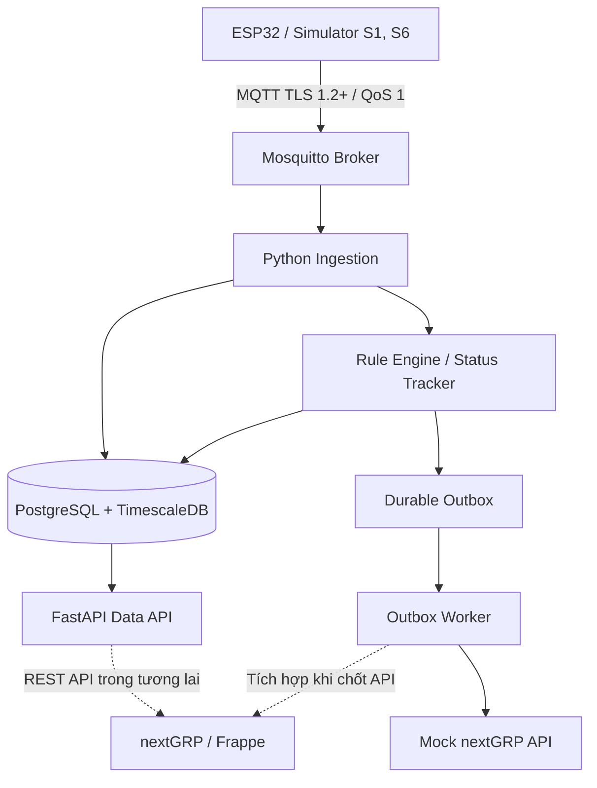

# nextWireless M1 — L2A Data Plane

**Nền tảng thu thập, xử lý và cung cấp dữ liệu IoT cho nextWireless Smart Office M1.**

Dự án xây dựng Data Plane độc lập để tiếp nhận dữ liệu từ thiết bị, lưu trữ telemetry, theo dõi trạng thái, xử lý quy tắc cảnh báo và cung cấp API tích hợp với **nextGRP/Frappe**. Hiện tại dự án là **bản thử nghiệm kỹ thuật (PoC)**, chưa phải hệ thống production.

## Kiến trúc



Hướng thiết kế dài hạn: dữ liệu từ các thiết bị và đường truyền khác nhau có thể được chuẩn hóa thông qua **Gateway / Protocol Adapter** và **Device Profile**, để tái sử dụng Data Plane trong nhiều lĩnh vực. Đây là định hướng phát triển, chưa phải chức năng đã triển khai đầy đủ.

## Công nghệ

| Thành phần | Công nghệ | Vai trò |
| --- | --- | --- |
| Giao tiếp IoT | MQTT, Paho MQTT | Nhận dữ liệu telemetry/event/status |
| MQTT Broker | Eclipse Mosquitto 2 | Phân phối bản tin từ thiết bị |
| Xử lý dữ liệu | Python 3.12 | Ingestion, Rule Engine, Status Tracker, Worker |
| API | FastAPI | Truy vấn dữ liệu và giám sát dịch vụ |
| Cơ sở dữ liệu | PostgreSQL 17 + TimescaleDB 2.30.2 | Lưu telemetry, sự kiện và trạng thái nghiệp vụ |
| Gửi cảnh báo | Durable Outbox | Lưu bền, retry, idempotency và xác nhận ACK |
| Triển khai | Docker Compose | Chạy các dịch vụ độc lập trong môi trường phát triển |

## Chức năng hiện có

- **S1 — Nhiệt độ/độ ẩm:** tiếp nhận `quality` ở top-level (`good` mặc định hoặc `error`); bản tin lỗi không chứa số đo giả. Cảnh báo khi nhiệt độ vượt 30 °C liên tục 300 giây, hysteresis 1 °C, phục hồi liên tục 120 giây và quiet window 600 giây.
- **S6 — Giám sát cửa:** giờ làm việc là thứ Hai–thứ Sáu, 08:00–18:00 theo `Asia/Ho_Chi_Minh`; ngoài lịch cảnh báo ngay, trong lịch cảnh báo khi cửa mở liên tục 300 giây. Timer xử lý khi không có MQTT mới và heartbeat `door_state` đối soát event bị mất.
- **Thiết bị:** theo dõi trạng thái online/offline; đã kiểm thử chu trình dừng/khởi động lại simulator.
- **Lưu trữ:** bảng `telemetry` đã được cấu hình là **TimescaleDB hypertable**.
- **Outbox Worker:** claim bằng `FOR UPDATE SKIP LOCKED`, lease bền vững, retry có backoff/jitter, kiểm tra ACK và chống gửi trùng theo `alarm_key`.
- **Kiểm thử:** Rule Engine và Outbox Worker đã được thử nghiệm với PostgreSQL và API nextGRP giả lập (mock).
- **MQTT security:** TLS 1.2+, kiểm tra certificate, tài khoản riêng, ACL theo
  thiết bị, QoS 1, retained status, LWT và tự động reconnect.

> **Lưu ý:** Trạng thái `DELIVERED` trong môi trường demo chỉ xác nhận API **mock** đã nhận cảnh báo; **không có nghĩa cảnh báo đã được gửi tới nextGRP thật**.

## Chạy dự án trên máy local

### Yêu cầu

- Docker Desktop với Docker Compose.
- PowerShell (Windows) hoặc terminal tương đương.

### Khởi động

```powershell
Copy-Item .env.example .env
notepad .env
```

Đặt giá trị riêng cho `PG_PASSWORD` trong `.env`, sau đó chạy:

```powershell
powershell -ExecutionPolicy Bypass -File scripts/generate-dev-mqtt-assets.ps1
docker compose --profile demo up -d --build
docker compose ps
```

Các cổng dùng cho demo:

| Dịch vụ | Địa chỉ |
| --- | --- |
| FastAPI | `http://127.0.0.1:8002` |
| MQTT TLS | `mqtts://127.0.0.1:8883` |
| PostgreSQL | Chỉ truy cập trong mạng nội bộ Docker |

### Kiểm tra hệ thống

```powershell
# Trạng thái API
curl.exe http://127.0.0.1:8002/api/v1/health

# Thống kê dữ liệu, trạng thái và cảnh báo
docker compose exec -T data-plane python check.py

# Kết quả từ TimescaleDB
docker compose exec -T postgres psql -U nw_user -d nextwireless -c "SELECT hypertable_name FROM timescaledb_information.hypertables;"

# Thống kê Outbox
curl.exe http://127.0.0.1:8002/api/v1/outbox/metrics

# Kiểm thử tự động
docker compose exec -T -e RUN_DB_TESTS=1 data-plane python -m unittest discover -v
```

Kiểm thử MQTT security cần tạm dừng simulator để tránh cạnh tranh retained status:

```powershell
docker compose stop simulator
docker compose --profile mqtt-test run --rm mqtt-security-test
docker compose start simulator
```

Quản lý credential/ACL mà không dừng toàn bộ stack:

```powershell
# Cấp tài khoản và ACL cho topic riêng
.\scripts\manage-mqtt-account.ps1 grant -Username SENSOR-002 -DeviceId SENSOR-002

# Đổi mật khẩu hoặc thu hồi quyền đăng nhập
.\scripts\manage-mqtt-account.ps1 password -Username SENSOR-002
.\scripts\manage-mqtt-account.ps1 revoke -Username SENSOR-002
```

Sau khi đổi mật khẩu, cập nhật secret trên chính thiết bị và reconnect thiết bị đó.
Thu hồi bằng password file chặn lần xác thực tiếp theo; để ngắt ngay một session
vật lý đang kết nối cần thêm cơ chế quản trị session/Dynamic Security.

Các API dữ liệu thử nghiệm:

```text
GET /api/v1/health
GET /api/v1/outbox/metrics
GET /api/v1/devices/TH-001/latest
GET /api/v1/devices/TH-001/telemetry?limit=5
```

Dừng các dịch vụ demo mà vẫn giữ dữ liệu:

```powershell
docker compose --profile demo stop
```

**Không chạy `docker compose down -v` nếu muốn giữ dữ liệu**, vì `-v` xóa các volume PostgreSQL và MQTT.

## Cấu trúc thư mục

```text
app/                 Python services, Rule Engine, API, Worker và tests
db/                  Schema và các SQL migration
firmware/            ESP32 ESP-IDF/PlatformIO dùng chung cho SHT31 và MC-38
mosquitto/           Cấu hình MQTT Broker
scripts/              Sinh TLS/credential và quản lý tài khoản MQTT
docs/                Ghi chú kỹ thuật
compose.yaml         Cấu hình Docker Compose
.env.example         Mẫu biến môi trường (không chứa mật khẩu thật)
```

## Giới hạn hiện tại và kế hoạch phát triển

- [x] MQTT TLS 1.2+, tài khoản riêng và ACL thiết bị cho development.
- [ ] Flash và kiểm thử firmware ESP32/SHT31, MC-38 trên phần cứng thực tế.
- [ ] Tích hợp API và đồng bộ Device/Profile/Rule/Status/Alarm thật với nextGRP (IF-01 đến IF-07).
- [ ] Hoàn thiện kiểm thử timeout, LWT, vận hành và bảo mật theo toàn bộ URD.
- [ ] Bổ sung chính sách retention, metrics/alert vận hành, backup/restore và benchmark mở rộng.
- [ ] Nghiên cứu Gateway/Protocol Adapter cho thiết bị công nghiệp và kết nối 4G/5G.

### Bảo mật

**Chỉ sử dụng Development CA cho local.** Broker chỉ bind `127.0.0.1`, không
mở ra Internet. `.env`, `.secrets/` và `mosquitto/certs/` đều bị Git ignore.
Dùng `scripts/manage-mqtt-account.ps1` để cấp/đổi/thu hồi tài khoản và reload
Mosquitto mà không dừng toàn bộ stack. Không bật gửi Alarm tới nextGRP thật.

Để chuẩn bị kết nối ESP32 trên Wi-Fi mà vẫn giới hạn firewall theo subnet, xem
[`docs/MQTT_LAN.md`](docs/MQTT_LAN.md). Compose tiếp tục bind loopback theo mặc
định; chỉ đặt `MQTT_BIND_IP` sau khi đã xác nhận IP/subnet và firewall rule.

Xem thêm ghi chú tại [`docs/TECH_NOTES.md`](docs/TECH_NOTES.md).

Tài liệu chuẩn bị thiết bị:

- [`docs/ESP32_PROVISIONING.md`](docs/ESP32_PROVISIONING.md)
- [`docs/ESP32_HARDWARE_SETUP.md`](docs/ESP32_HARDWARE_SETUP.md)
- [`docs/ESP32_TEST_CHECKLIST.md`](docs/ESP32_TEST_CHECKLIST.md)
