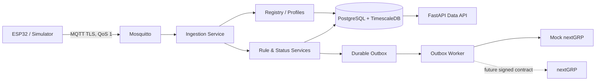

# nextWireless M1 Data Plane

An MQTT-based IoT data plane for nextWireless Smart Office M1. It receives device telemetry,
events and presence, stores time-series data in PostgreSQL/TimescaleDB, evaluates durable rules,
delivers alarms through an outbox, and exposes a read-only API.

This repository is a tested development PoC. It is not a production nextGRP integration and has
not been validated on physical ESP32/SHT31/MC-38 hardware.

## Key Features

- MQTT 3.1.1 over TLS 1.2+, QoS 1, per-device credentials and topic ACLs.
- Temperature/humidity telemetry and door event/status contracts.
- Organization, Site, Zone, Device and Device Profile registry.
- Device, Profile, Zone, Site and Organization rule scopes with per-device runtime state.
- TimescaleDB telemetry storage and idempotent report/event ingestion.
- Durable alarm outbox with leases, retry/backoff, ACK validation and replay safety.
- Read-only FastAPI endpoints with a development-only organization context.
- ESP-IDF/PlatformIO firmware for SHT31 and MC-38 devices.
- Unit, PostgreSQL, MQTT security, end-to-end and firmware contract tests.

## System Architecture



The Python backend is a modular application deployed as separate Compose processes. Runtime
processes share one PostgreSQL schema; this is intentionally not presented as independent
microservices.

## Tech Stack

| Area | Technology |
| --- | --- |
| Device transport | MQTT, Paho MQTT, Mosquitto 2 |
| Backend/API | Python 3.12, FastAPI, Uvicorn |
| Database | PostgreSQL 17, TimescaleDB 2.30.2, psycopg 3 |
| Firmware | ESP32, ESP-IDF, PlatformIO, C++17 |
| Local deployment | Docker Compose, PowerShell helper scripts |

## Project Structure

```text
app/
  api/             FastAPI application and tenant dependency
  core/            shared database and clock utilities
  ingestion/       topic and payload contracts
  integrations/    external adapters, including provisional nextGRP
  outbox/           durable delivery worker and store
  registry/         organization/site/device/profile queries
  rules/            rule evaluation and durable state machines
  status/           device presence and timeout handling
  *.py              stable process entrypoints and compatibility modules
db/migrations/      canonical SQL migrations 001–008
tests/
  unit/             tests without external services
  integration/      PostgreSQL and mock-service tests
  security/         MQTT TLS/auth/ACL/QoS/LWT tests
  e2e/              full simulator-style data-flow tests
firmware/            ESP-IDF/PlatformIO source and firmware tests
mosquitto/           development broker configuration and ACL
scripts/             provisioning, migration and LAN helper scripts
docs/                design, operations and audit documentation
compose.yaml         local development stack
```

## Prerequisites

- Docker Desktop with Docker Compose.
- PowerShell on Windows for the documented helper workflow.
- PlatformIO Core and the repository firmware virtual environment for firmware builds.

## Quick Start

From the repository root:

```powershell
Copy-Item .env.example .env
notepad .env
powershell -ExecutionPolicy Bypass -File scripts/generate-dev-mqtt-assets.ps1
docker compose --profile demo up -d --build
docker compose ps
```

Set a strong local `PG_PASSWORD` in `.env`. The asset script creates ignored development MQTT
credentials and certificates. By default MQTT and the API bind only to loopback.

Verify the running services:

```powershell
curl.exe http://127.0.0.1:8002/api/v1/health
curl.exe http://127.0.0.1:8002/api/v1/outbox/metrics
curl.exe -H "X-Org-Code: demo" http://127.0.0.1:8002/api/v1/devices
docker compose exec -T data-plane python check.py
```

Stop the demo without deleting data:

```powershell
docker compose --profile demo stop
```

Do not run `docker compose down -v` when the PostgreSQL or MQTT volumes must be preserved.

## Environment Configuration

| Setting | Required | Purpose |
| --- | --- | --- |
| `PG_PASSWORD` | Yes, in ignored `.env` | PostgreSQL application password |
| `MQTT_BIND_IP` | No; defaults to `127.0.0.1` | Explicit broker bind address |
| `MQTT_*` credentials | Generated | Stored in ignored `.secrets/*.env` |
| `DB_HOST`, `DB_PORT`, `DB_NAME`, `DB_USER` | Compose provides | Database connection settings |
| `RULE_TIMER_INTERVAL` | No; default 5 seconds | Due-rule/status timer cadence |
| `OUTBOX_*` | Compose provides demo defaults | Delivery batch, lease and retry policy |
| `NEXTGRP_*` | Mock only in Compose | Provisional receiver URL/auth settings |

Never commit `.env`, `.secrets/`, private keys, generated NVS images or device passwords. LAN
exposure is opt-in and must follow [MQTT_LAN.md](docs/hardware/MQTT_LAN.md); no LAN IP is a repository-wide
default.

## Testing

Run Python syntax and tests in the application image:

```powershell
python -m compileall -q app tests
docker compose exec -T data-plane python -m unittest discover -s tests -v
docker compose exec -T -e RUN_DB_TESTS=1 data-plane `
  python -m unittest discover -s tests/integration -v
```

Validate migrations 001–008 twice on an isolated database:

```powershell
powershell -ExecutionPolicy Bypass -File scripts/test-migrations-fresh.ps1
```

MQTT security and ingestion tests require the simulator to be stopped to avoid retained-message
competition:

```powershell
docker compose stop simulator
docker compose --profile mqtt-test run --rm mqtt-security-test
docker compose --profile mqtt-test run --rm `
  -e RUN_MQTT_INGESTION_TESTS=1 mqtt-security-test
docker compose start simulator
```

Run the end-to-end suite against the Compose mock:

```powershell
docker compose --profile mqtt-test run --rm `
  -e RUN_E2E_TESTS=1 `
  -e MOCK_TEST_URL=http://mock-nextgrp:8080/mock/v1/alarms `
  -e MOCK_TEST_TOKEN=mock-development-token `
  mqtt-security-test python -m unittest -v tests.e2e.test_e2e_simulator
```

`mock-development-token` is a public local-test value, not a production credential.

## ESP32 Firmware

Build both device variants and run firmware contract tests:

```powershell
firmware\.venv\Scripts\python.exe -m platformio run -d firmware -e sht31
firmware\.venv\Scripts\python.exe -m platformio run -d firmware -e reed_door
firmware\.venv\Scripts\python.exe -m unittest discover -s firmware\tests -v
```

Provisioning requires a confirmed broker hostname/IP that appears in the certificate SAN. See:

- [Firmware overview](firmware/README.md)
- [ESP32 provisioning](docs/hardware/ESP32_PROVISIONING.md)
- [Hardware setup](docs/hardware/ESP32_HARDWARE_SETUP.md)
- [Functional checklist](docs/hardware/ESP32_TEST_CHECKLIST.md)

Physical-device validation remains pending.

## API & Documentation

Operator endpoints:

```text
GET /api/v1/health
GET /api/v1/outbox/metrics
```

Data endpoints require `X-Org-Code`:

```text
GET /api/v1/devices
GET /api/v1/devices/{device_id}/latest
GET /api/v1/devices/{device_id}/telemetry
GET /api/v1/devices/{device_id}/status
GET /api/v1/devices/{device_id}/events
GET /api/v1/alarms
```

`X-Org-Code` is a forgeable development context, not production authentication or RBAC.

Related documentation:

- [Dev 1 integration handoff](docs/integration/DEV1_INTEGRATION_HANDOFF.md)
- [Dev 1 Dashboard API guide](docs/integration/DEV1_DASHBOARD_API_GUIDE.md)
- [Dev 1 pending confirmations](docs/integration/DEV1_PENDING_CONFIRMATIONS.md)
- [Dev 2 final validation report](docs/M1_DEV2_FINAL_REPORT.md)
- [Technical notes](docs/TECH_NOTES.md)

## Current Status

- Software behavior is implemented for the M1 simulator and local Compose environment.
- SQL migrations 001–010 are canonical under `db/migrations/`.
- Multi-organization registry and scoped rule runtime are implemented.
- nextGRP delivery remains a provisional mock contract.
- ESP32 source builds exist, but physical hardware acceptance is pending.
- Production identity/RBAC, control-plane synchronization, retention, backup and scale benchmarks
  are not complete.

See the [Dev 2 final report](docs/M1_DEV2_FINAL_REPORT.md) for current validation and handoff
readiness evidence.

## Roadmap

1. Agree the authoritative nextGRP identity, registry, rule and alarm contracts.
2. Replace the development tenant header and mock alarm adapter with verified integration.
3. Automate device credential/ACL lifecycle from the control plane.
4. Complete physical ESP32/SHT31/MC-38 testing and recovery/soak evidence.
5. Define retention, backup/restore, observability and capacity targets.
6. Evaluate signed OTA, Secure Boot, flash encryption and production credential rotation.
